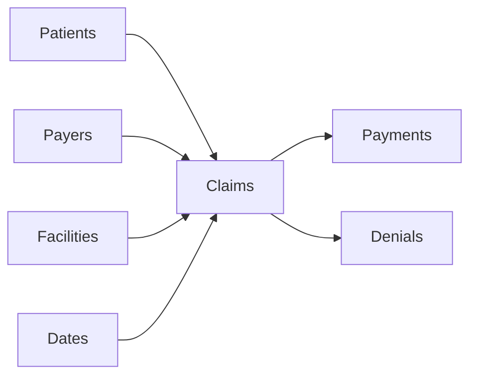

# Healthcare revenue-cycle analytics | Power BI report kit

Healthcare revenue-cycle analysis on **synthetic** claims data, with example measures for collections, initial denials and aging. No real patient information, PHI or employer data is used.

## Semantic model

## Build the Power BI report

1. Import the seven CSV files from `data/` into Power BI Desktop. Rename the tables Claims, Payments, Denials, Patients, Payers, Facilities and Dates. Set numerical IDs and monetary cents as whole numbers; cast date fields to Date.
2. Create single-direction, one-to-many relationships from Patients, Payers, Facilities and Dates to Claims. Create Claims-to-Payments and Claims-to-Denials by ClaimID.
3. Add the DAX measures and calculated columns from `measures.dax` individually.
4. Build three pages: **Executive summary** (collection and denial KPIs), **Denials** (root causes and recovery) and **A/R aging** (payer/facility filters and aging buckets).
5. Run `python validate.py` to check dataset arithmetic and key integrity.

## Metrics

The synthetic sample contains 1,000 claims. The validation script calculates claims, denials, allowed amounts, paid amounts, outstanding A/R and the collection rate directly from the CSVs.

## Limitations

This is a **Power BI report-building kit**, not a published `.pbix`. The SVG preview is an illustrative local visualization, **not** an actual Power BI Desktop screenshot. DAX has not been executed in Power BI Desktop.
