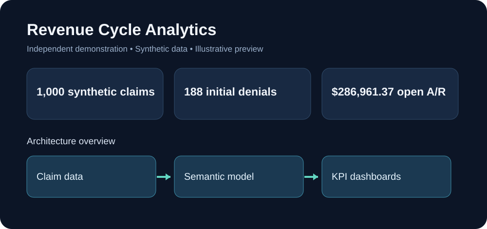
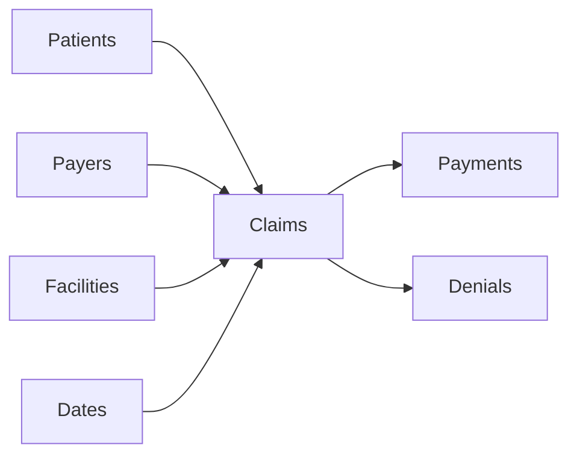

# Healthcare Revenue Cycle Analytics
**Power BI · DAX · Data Modeling · Claims Analysis** | Independent portfolio project

A reproducible revenue-cycle report-building kit using *fully synthetic* claim, payment, denial, patient, payer, facility, and date tables. It explores initial denials, collections, and aging by payer and facility.

## Business question
How can healthcare operations teams monitor payments, identify initial denials, and prioritize outstanding accounts receivable (A/R) with consistent measures?

## Data model

## Verified synthetic dataset
Run `python validate.py` with Python 3.10+.

| Metric | Computed result |
|---|---:|
| Claims | **1,000** |
| Initial denials | **188** |
| Initial denial rate | **18.8%** |
| Allowed amount | **$867,887.99** |
| Payments | **$580,926.62** |
| Outstanding A/R | **$286,961.37** |
| Collection rate (paid ÷ allowed) | **66.94%** |

The synthetic inputs reconcile: **allowed amount = payments + open A/R**. These figures are demonstration data, not real provider performance.

## Building the Power BI report
1. Import the seven CSVs from `data/` and rename them `Claims`, `Payments`, `Denials`, `Patients`, `Payers`, `Facilities`, `Dates`.
2. Set ID and monetary-cent columns to Whole Number; date columns to Date. Create one-to-many, single-direction dimension → claims relationships, plus Claims → Payments and Claims → Denials by `ClaimID`.
3. Add each measure and calculated column from `measures.dax` **individually**.
4. Build pages for **Executive KPIs**, **Denial analysis** and **A/R aging**. Filter by payer and facility, and validate results against `python validate.py`.

## Included
- `data/` — seven related synthetic CSV tables
- `measures.dax` — 14 draft measures and two calculated columns
- `validate.py` — arithmetic and referential checks
- `docs/preview.svg` — illustrative report overview

**Scope:** this is a **Power BI development kit**, not a completed `.pbix` or a published Power BI dashboard. DAX has not been validated in Power BI Desktop; the image is an illustrative diagram, not an exported Power BI screenshot. No PHI or employer data.
